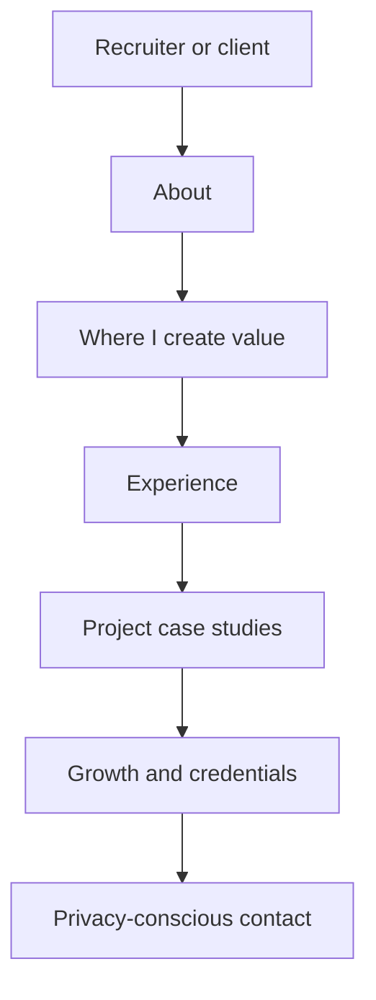
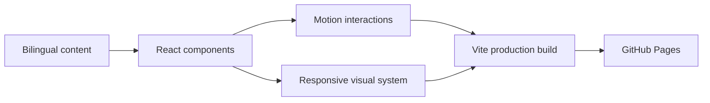

# Emiliano González Romo — Engineering Portfolio

<p align="left">
  <strong>A bilingual portfolio for Forward Deployed, AI Solutions, and customer-facing engineering roles.</strong>
</p>

[](https://h8hyf2rw9y-afk.github.io/Portfolio/)
[](https://github.com/h8hyf2rw9y-afk/Portfolio)
[](https://h8hyf2rw9y-afk.github.io/Portfolio/)
[](https://h8hyf2rw9y-afk.github.io/Portfolio/)

## Open the experience

### [h8hyf2rw9y-afk.github.io/Portfolio →](https://h8hyf2rw9y-afk.github.io/Portfolio/)

This portfolio is designed for a short recruiter scan and a deeper technical review. It explains who I am, where I create value, what I have built, how I work with customers, and which engineering capabilities I am strengthening.

## Why this portfolio exists

My work sits between **customers, product, and engineering**. A conventional project gallery did not explain that clearly enough.

The site therefore presents projects as operating stories:

1. What problem existed?
2. Who experienced it?
3. What system was built?
4. What did I own?
5. Which technical decisions made the solution reliable?
6. What happened after deployment?

The central example is **PropPilot**, Oniria's real-estate operations product. It originated from workflows I observed inside Crestify, is now operating in that company, and is being prepared for expansion to additional real-estate businesses.

## Experience architecture



| Section | Purpose |
| --- | --- |
| About | Establish the customer-to-production story in under 120 words |
| Where I create value | Explain customer discovery, end-to-end engineering, and controlled AI |
| Experience | Connect commercial, operational, and engineering work |
| Selected work | Present real projects with context, contribution, stack, and status |
| What I'm leveling up | Show disciplined growth without hiding current boundaries |
| Credentials | Separate completed programs from coursework in progress |

## Featured engineering story — PropPilot

PropPilot is a working platform for real-estate acquisition and property-flipping operations. It organizes contacts, properties, acquisition cases, debts, offers, tasks, appointments, and controlled AI assistance.

**My ownership**

- Customer and workflow discovery
- Product definition and domain modeling
- Next.js and TypeScript frontend
- FastAPI API and service architecture
- PostgreSQL persistence with SQLAlchemy
- Alembic database migrations
- Supabase authentication and JWT access
- Pydantic validation
- Automated testing and CI/CD
- LLM field allowlists and human confirmation

[Open PropPilot →](https://state-ai-frontend.vercel.app/)  
[Read the engineering case study →](https://github.com/h8hyf2rw9y-afk/StateAI-Overview)

## Frontend architecture



| Layer | Implementation |
| --- | --- |
| Application | React 19, TypeScript, Vite |
| Interaction | Motion and accessible disclosure patterns |
| Icons | Lucide React |
| Content | Typed English and Spanish project, experience, and credential data |
| Styling | Responsive CSS, theme variables, reduced-motion support |
| Delivery | GitHub Actions and GitHub Pages |

## Product and interface decisions

### Recruiter-first information hierarchy

The most relevant information appears before detailed tools or credentials: positioning, value, experience, and verified work.

### Progressive disclosure

Experience, projects, capabilities, learning, and credentials can expand when a visitor wants more detail. This keeps the first scan concise without removing technical depth.

### Bilingual by design

English and Spanish content share typed data structures rather than separate pages. The selected language persists locally.

### Motion with boundaries

Animations support hierarchy and transitions. The site honors reduced-motion preferences and keeps the primary content readable without animation.

### Privacy-conscious presentation

- Personal contact information is masked in the client.
- No private client records, credentials, prompts, or proprietary source code are published.
- Private products use sanitized case studies.
- Collaborative, academic, and individually owned projects are labeled separately.
- External links open with safe relationship attributes.

## Selected work represented

| Project | Context | What it demonstrates |
| --- | --- | --- |
| PropPilot | Oniria product operating inside Crestify | Discovery-to-production ownership, full-stack architecture, applied AI, security |
| Crestify | Professional real-estate operations | Domain expertise, product thinking, sales and operational leadership |
| HackMTY · Capital One | 48-hour Monterrey hackathon | Rapid prototyping and team delivery |
| Dilo en Señas | Collaborative accessibility system | React Native, API integration, inclusive design |
| FRIDA PDF Analyst | Collaborative document-intelligence system | File workflows, authentication, structured analysis UI |
| BabyDuck Compiler | Individual academic project | Parsing, semantic analysis, intermediate representation, virtual machine |
| Autonomous Harvest Simulation | Academic AI project | Agent modeling, reward design, Unity ML-Agents |
| Raíces | Personal interactive story | Visual storytelling, responsive design, accessible motion |

Some earlier collaborative repositories are hosted by former teammates or on a secondary account. The portfolio identifies the context and my contribution rather than claiming sole ownership.

## Local development

Requires Node.js 20.19 or newer.

```bash
git clone https://github.com/h8hyf2rw9y-afk/Portfolio.git
cd Portfolio
npm install
npm run dev
```

## Verification

```bash
npm run build
npm run audit
```

The production build runs TypeScript checks before Vite generates the deployable assets.

## Repository structure

```text
src/
├── components/       Reusable interface and interaction components
├── data/             Typed projects, experience, and credentials
├── App.tsx           Page composition and modal behavior
└── styles.css        Responsive visual system and themes
```

## Public links

- [Live portfolio](https://h8hyf2rw9y-afk.github.io/Portfolio/)
- [Primary GitHub profile](https://github.com/h8hyf2rw9y-afk)
- [PropPilot engineering case study](https://github.com/h8hyf2rw9y-afk/StateAI-Overview)
- [LinkedIn](https://www.linkedin.com/in/emiliano-gonzalez-tech/)

---

Built to show the work behind the résumé: the customer context, technical decisions, implementation, and outcome.
